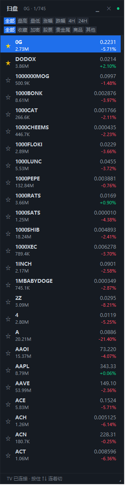

# 透明悬浮行情小窗

Windows 桌面上的全品种行情监控条，实时显示 BTC / ETH / SOL 等自选加密货币价格。
纯 Python 标准库实现（tkinter + urllib），**不需要 pip 安装任何依赖**。

> GitHub：<https://github.com/bin2c/crypto-ticker>
> 免安装 exe（不用装 Python，双击就跑）：<https://github.com/bin2c/crypto-ticker/releases/latest>

```
BTC  ◎ 多82,000   82,484.92   -2.33%
ETH  ◎ 空2,492.5   2,566.83   -4.37%
SOL  ◎            116.34      -3.40%
```

外观有三档：**纯色卡片（默认，v0.33 起）** / 毛玻璃 / 纯文字悬浮（背景全透明）。
老版本默认是纯文字透明；透明底在 Windows 上连命中测试一起被抠掉，
点不到也拖不动，所以 v0.33 把默认换成了实底卡片，老配置会自动迁移。

默认的卡片模式是**深色实底 + 圆角**（浅色主题下是白底），想更"贴桌面"可以在
右键菜单 → 外观 →「毛玻璃」或「纯文字（背景全透明）」里换。

（`◎ 多82,000` 是 v0.16 加的**仓位 / 关注价位标记**，见下面「仓位 / 关注价位」。）

## 启动

| 方式 | 操作 |
| --- | --- |
| 推荐 | 双击 **`行情条.exe`**（免装 Python、无控制台；已在开始菜单里叫「行情条」） |
| 也行 | 双击 `启动.vbs`（无控制台窗口）／`启动.bat`（会带一个黑窗） |
| 命令行 | `python ticker.py` |
| 开机自启 | 双击 `开机自启.bat`，会在「启动」文件夹建快捷方式 |

> 从 **v0.30** 起有**单实例锁**：不管用哪种方式双击，只要有一个人在跑，
> 新启动的那个会自己退出、并把已经在跑的窗口提到最前面 —— 不会再多开一个抢热键。

> ⚠️ 以前的坑：同时开两个的话，第二个的热键会被第一个抢走
> （自动变成 `Ctrl+Shift+Alt+H` 这种备用组合），自选和位置也会互相覆盖。
> 现在有锁了，这种情况不会再有。

**装进开始菜单 / 桌面**

- 开始菜单：已经放了 `行情条` 快捷方式（在「所有应用」里，搜"行情条"也能搜到）。
  想钉到「开始」屏幕磁贴：开始菜单里右键 → **固定到"开始"屏幕**。
- 桌面：右键 `行情条.exe` → 发送到 → 桌面快捷方式
- 想让它开机就跑：`开机自启.bat`

### 侧边栏（悬浮扫盘条）怎么打开

三个入口，任选：

- 小窗口底栏的 **「扫盘」**（在「更多 ▸」左边）——点一下侧边栏就弹出来；
- 热键 **Ctrl+Shift+Alt+F**（Ctrl+Alt+F 常被别的软件占着，程序会自动顺延到备用组合，
  实际生效的写在右键菜单那一条上）；
- 右键菜单 →「悬浮扫盘条」，或 设置 → 显示 →「打开悬浮扫盘条」。

弹出来之后按 **↑ / ↓** 一路扫，TradingView 在右边自己跟着换；Esc 关掉。

### 背景透明、窗口拖不动（v0.33 修好）

以前默认外观是「纯文字悬浮（背景全透明）」。这种模式的底色是**色键色**，
而 Windows 对色键透明的像素是**连点击一起抠掉**的 —— 整个窗口只有字形那几像素能接鼠标，
所以会出现"看着在桌面上、可是按不住、也拖不走"的感觉。

现在默认改成**纯色卡片**（实底、带圆角），整块面板按住就能拖。老配置会自动迁移一次
（`ticker.log` 里会看到 `外观从「纯文字全透明」迁移为「纯色卡片」`）。
还想用透明悬浮：右键菜单 → 外观样式 → 纯文字悬浮，但那张模式**空白处依然点不到**（系统行为）。

### 界面字发粉 / 文字叠在一起（v0.32 修好）

以前有概率出现两种"看起来很坏"的现象，跟 exe / BAT 无关，源码版一样会出现：

- **同一格里两个价格叠着**（`80,978.05` 和 `80,909.93` 摞在一起）——
  `render()` 被重入（里面 `update_idletasks()` 会当场处理事件，事件里又有人调 `render()`），
  内层画完外层接着在同一张画布上画，两帧就叠上了。现在 `render()` 有重入保护。
- **文字整行发亮粉色、边上还带青色** —— 纯文字模式的透明色键以前固定是洋红 `#ff00fe`，
  而文字是抗锯齿画的，边缘等于"字色和色键按比例混"，黑字混洋红就成了粉字。
  现在色键跟着字色走（黑字配白键、白字配近黑键），边缘是自然羽化。

> 想确认自己跑的是不是新版：看 `ticker.log` 里的 `界面自检: v0.32 …` 那一行。

### 行尾的 × / 🔔 图标不见了（v0.36 修好）

这两个图标是开关项，读的是 `config.json` 里的 `show_del` / `show_alert`。以前默认 `false`，
所以**配置文件少了这个键，图标就静默消失**（真遇到过：行尾 `×` 突然没了）。
现在默认 `true`，键丢了也照样显示。不想看的话：右键菜单 →「显示删除按钮（行尾 ×）」
/「显示提醒铃铛」，勾掉即可。

## 拿到别的电脑上用（打包 / 发布）

**① 不想装 Python → 打包成一个 exe**

双击 **`打包exe.bat`**（第一次会自动装 PyInstaller，需要联网），跑完得到
**`dist\行情条.exe`** —— 就这一个文件，图表库已经塞进去了：

- 拷到任何 Windows 电脑，**双击即用**，目标机器不用装 Python
- 第一次运行会在 exe 旁边自动生成 `config.json` 和 `ticker.log`
  （配置/日志跟着 exe 走，不写进系统目录）
- 打包脚本还会把 exe **复制一份到仓库根目录**（`行情条.exe`）—— 开始菜单里的
  「行情条」指向的就是这一个，它和 `ticker.py` 同目录，所以配置/日志是同一份
- 想发给别人：GitHub 仓库页 → **Releases** → 把 exe 拖进去发布

**② 想要源码 → 传 GitHub**

看 **[发布到GitHub.md](发布到GitHub.md)**，里面是照抄就能用的命令
（建仓库 → `git add/commit/push` → 换电脑 `git clone`）。

> ⚠️ **`config.json` 永远不会进仓库**：里面有你的 QQ 邮箱授权码。
> 仓库里放的是 `config.example.json`（空的模板），第一次用复制一份改名即可。
> 仓库的 `.gitignore` 已经挡住了 `config.json`、`ticker.log`、`symbols.json`、
> `build/`、`dist/`，提交前用 `git status --short` 再确认一眼。

**③ 换电脑后第一次跑**

```powershell
git clone <你的仓库地址>
cd crypto-ticker
copy config.example.json config.json
python ticker.py
```

## 全局热键（窗口被游戏挡住也能用）

| 热键 | 作用 |
| --- | --- |
| `Ctrl+Alt+H` | 显示 / 隐藏 |
| `Ctrl+Alt+G` | **游戏模式**：锁住鼠标防误触，再按一次解开 |
| `Ctrl+Alt+M` | 在鼠标位置弹出设置菜单 |
| `Ctrl+Alt+K` | 打开**品种选择器** |
| `Ctrl+Alt+S` | 打开**全品种扫盘**（全市场 700+ 品种，↑↓ 快速扫） |
| `Ctrl+Alt+F` | 打开 / 收起**悬浮扫盘条**（贴左边缘，按住 ↓ 连着切 TradingView）<br>被占用时自动换 `Ctrl+Alt+D` → `Ctrl+Shift+Alt+F` |
| `Ctrl+Alt+P` | 鼠标穿透开关（整个窗口连文字都不挡点击） |

> 热键被别的软件占用时会**自动换备用组合键**。
> 实际生效的那个组合，**直接写在右键菜单上**：
> 「隐藏窗口（Ctrl+Alt+H）」「游戏模式（锁鼠标 · Ctrl+Alt+G）」，
> 另外「热键 ▸」子菜单里五个功能全都列着。忘了就右键看一眼。

## 仓位 / 关注价位（盯自己的仓）

**每个品种名字后面有个小圆点按钮 ◎**，点它就弹一个小窗：

| 你填的 | 行里显示成 | 颜色 |
| --- | --- | --- |
| 价位 + **做多** | `多82,000` | **红** |
| 价位 + **做空** | `空2,492.5` | **绿** |
| 价位 + **仅关注** | `看109.8123` | 琥珀 |

- 价位可以**随便填**（`82500`、`2492.5`、`0.1407` 都行），
  旁边有个「现价」按钮，一键填当前价
- 已经设过的再点开，会带出原来的值，可以改、可以「删除标记」
- **做多是红、做空是绿**（和你菜单里选的"涨跌配色"无关——
  这个说的是"我站在哪一边"，不是"行情涨还是跌"）
- 标记的**字号比价格数字小一号**、颜色也不一样，不会和行情数字看混
- 存在配置里，**重启还在**；菜单「**仓位 / 关注价位**」里可以
  关掉整列（「显示仓位标记」）或者「清空全部标记」

## 游戏模式（打游戏怕手滑）

`Ctrl+Alt+G` 按一下：

- 行情条**完全不接鼠标**：拖不动、点不动、双击不跳图表、滚轮也不改透明度，
  连行尾的闹铃和 × 都点不到
- 顺手打开**鼠标穿透**，所以在行情条上点击会**落到游戏里**，不会白白吃掉你一次点击
- 输入栏右边会亮一个 `🔒 游戏模式`
- 再按一次 `Ctrl+Alt+G` 解开；忘了热键就 `Ctrl+Alt+M` 弹菜单点掉

> 游戏模式**不写进配置**：重启程序必定回到正常状态，
> 免得哪天忘了自己开过、鼠标怎么点都没反应还以为坏了。

## 全品种扫盘（一路扫完整个市场）

`Ctrl+Alt+S`，或右键菜单 →「全品种扫盘（全市场 · ↑↓ 切）…」，
或「选择品种」对话框右下角的「全品种扫盘 ▸」。

新开一个页面（`/scan`），左边是**全市场所有品种**，右边还是那套完整图表
（K 线、周期切换、**趋势线全都在**）：

| 你能扫到的 | 数量 |
| --- | --- |
| 加密币永续 | 523 个 |
| **股票合约**（TSLA / NVDA / AAPL / MSFT / META / AMZN / COIN / MSTR / GOOGL …） | 178 个 |
| **原油 / 商品**（`CL` 西德克萨斯原油、`BZ` 布伦特、天然气、铜 …） | 6 个 |
| **黄金 `XAU` / 白银 `XAG`** | 2 个 |
| 其他 TradFi + 指数（US500 等） | 32 个 |

**怎么快速扫：**

| 按键 | 作用 |
| --- | --- |
| `↓` 或 `j` | **切到下一个品种**（图立刻跟着换） |
| `↑` 或 `k` | 上一个 |
| `PageDown` / `PageUp` | 一次跳 10 个 |
| `Home` / `End` | 跳到第一个 / 最后一个 |
| `/` | 跳到搜索框 |
| 点一行 | 也可以直接点，选中就换图 |

- 选中行会**自动滚到可见区域**，一路按 ↓ 不会跟丢
- 顶部有**分类胶囊**：全部 / 加密 / 股票 / 贵金属 / 原油·商品 / 其他 TradFi
- 搜索框可以打 `XAU`、`TSLA`、`NVDA` 直接定位
- 想回原来的行情图表页：点左上「← 行情图表」，或者从行情条换个品种也行
  （换品种会自动切回图表页）

## 悬浮扫盘条（一边看 TradingView，一边按着 ↓ 连着切）

`Ctrl+Alt+F`，或右键菜单 →「悬浮扫盘条」。



屏幕左边会冒出一条 264px 宽的置顶小面板。它打开的时候会**全局接管**
`↑ ↓ PageUp PageDown Home End Esc`（用 Windows 的 RegisterHotKey），
所以 TradingView **一直留在前台不用切**，你按住 ↓ 它就一路往下扫：

| 按键 | 作用 |
| --- | --- |
| `↓` / `↑` | 下一个 / 上一个，**按住不放会连续切**（约 75ms 一行），TV 跟着连换 |
| `j` / `k` | 同上（只在点过小条、焦点在它身上时） |
| `PageDown` / `PageUp` | 一次 10 行 |
| `Home` / `End` | 第一个 / 最后一个 |
| 鼠标点一行 / 滚轮 | 直接选 / 滚 3 行（右边还有一条细滚动条，可以直接拖） |
| 点行首的 `☆` | 收藏 / 取消收藏（收藏会存进配置，跟扫盘页的 ♥ 是同一份） |
| 拖标题栏 | 挪位置（自动记住） |
| **拖右下角 `◢` / 底边** | **改大小 —— 宽度、行数随便拉，松手自动吸附到整行并记住** |
| **点标题栏右边的 `▁`** | **一键缩成小窗**（176×166，只留品种名 + 涨跌幅，5 行）；点 `▣` 恢复原来的大小 |
| **点 `—`（`▁` 左边那个）** | **最小化到任务栏**；点任务栏图标 / 按 `Ctrl+Alt+F` / 点「扫盘」都能还原（v0.39） |
| `Esc` 或 `✕` | 关掉（关掉立刻把方向键还给系统） |

每一行是两行字：上面品种名，下面一行小字是 **24 小时成交额**（`1.2B` 这种），
右边是价格 + 涨跌幅 —— 跟币安侧边栏选币的排法一样。

顶部两排小标签：

- **排序**：`全部`（A→Z）/ `量高` / `量低` / `涨幅` / `跌幅` / `4H` / `24H`。
  - 前五个都是**整张榜全排**（不是只给前 10 个），按 ↓ 可以一路扫到第 700 个。
  - `4H` / `24H` 是**持仓量变化榜的前 20 名**（币安 `openInterestHist` 接口算的，
    不是第三方网站抄的），右列显示的是这段时间的持仓变化 %，不是涨跌幅。
- **分类**：`全部` / `收藏` / `加密` / `股票` / `贵金属` / `商品` / `其他`。
  选中的分类和排序都会记到配置里，下次打开还是那样。

`收藏` 那一栏就是你的小观察列表：自选装不下的、临时想盯的几个币，
点行首 `☆` 收进来，之后在 `收藏` 里按 ↓ 一个个看，TV 跟着换。
收藏项的行首是金色实心 ★（**不再插到榜单最前面** —— v0.38 之前那样做会把每个榜的
头两行都占掉；想看收藏就切到「收藏」分类）。

> `4H` / `24H` 算的是**币安永续**的持仓量变化（免费接口，520 个币约 20 秒）。
> [coinalyze](https://coinalyze.net/) 那种是**多交易所聚合**，数字会不一样，不是算错；
> 悬浮条在这两个模式下页脚会写「币安持仓4H」提醒你口径。
> 到最后一格再按 ↓ 不会跳回第一个，就停在那儿（v0.38 起）。

- 想让它完全不挡图：点 `▁` 缩成小窗（176px 宽、5 行），拖到屏幕角落就行 ——
  小窗里 `↑↓` 一样是全局的，TV 照样跟着换，只是不显示价格列了
- 想彻底收进任务栏：点 `—`。还原有三条路：任务栏图标 / `Ctrl+Alt+F` / 小窗底栏的「扫盘」
- **状态会记住**：关掉再打开会回到上次那个品种、那个榜单、那个分类、那个大小和位置
  （`config.json` 里的 `float_sel` / `float_mode` / `float_cat` / `float_compact` / `float_size` / `float_pos`）
- 宽度拉到 220px 以下时 chip 会自动换成 7pt 小字、更紧的间距，名字也会截得更短，
  保证两排标签不会被窗口右边裁掉
- 小条开着的时候方向键是它的 —— 别的程序（包括 TV）收不到，关掉就还回去
- 右边的 TV 不会被最小化、也不会被抢焦点，只是**品种**在换；画线、指标、周期都留着
- 左下角小字：绿点「TV 已连接」= 扩展在线；黄点「未连接」= 扩展没装或浏览器没开
- 「联动 TradingView」的完整说明（含扩展安装）见 [`TradingView联动.md`](TradingView联动.md)

## 自选品种

`Ctrl+Alt+K`，或行情条上的「更多 ▸」，或右键菜单 →「选择品种…」。

- 用 **上移 / 下移** 调整顺序，**删除**移除选中项
- 点「保存并应用」立即生效并写入配置
- **加新币在主窗口底部输入**（见下面的「窗口内直接输入」），
  对话框里不再重复放一个搜索框
- 对话框里的四组榜单（成交量/涨幅/跌幅/增仓前 10）**点标题就在原地展开**：
  - **单击**一项 = 加进自选（**列表不关**，可以一路点下去，加过的会打 ✓）
  - **双击**一项 = 直接切到那个品种的图表
  - 再点一次同一个标题就收起；点别组的标题会换过去

### 删掉自选：行尾的小 ×

右键菜单里把「**显示删除按钮（行尾 ×）**」打开，每行末尾会出现一个小 `×`：

**点一下就直接删掉**（没有二次确认）。

> 删的正好是图表当前品种时，会自动往前挪一个，不让图表停在已删的币上。

## 价位提醒（到价叫我）

**每行最右边有个闹铃 🔔**，点一下就能设提醒。有提醒的品种铃铛会**亮成黄色**。

| 能设的 | 说明 |
| --- | --- |
| **方向** | 上破（涨到某个价）/ 下破（跌到某个价） |
| **提醒方式** | 电脑弹窗 / QQ 邮箱（可以两个都勾） |
| **重复** | **只提醒一次**（响过就停） / **反复提醒** |

**「反复提醒」不会刷屏**：响过一次之后，价格要**回到目标价的另一边**，
下次再碰到才会再响。不然价格在目标价上下抖动会把你轰炸一遍。

弹窗里还能：**改这条**（改完点「添加提醒」保存）、**启用/停用**、**删除**。

### 想确认提醒到底通不通

右键菜单 →「**测试提醒（弹窗+邮件）**」，会立刻走一遍真通知 + 真邮件。
提醒是"关键时刻要能用"的功能，别等真到价了才发现没配好。

> 提醒存在内存里，**重启行情条就清空**。这是"今天盯一下"的临时工具。

### 让提醒发到 QQ 邮箱

右键菜单 →「价格提醒设置…」→「邮箱设置…」：

| 填什么 | 注意 |
| --- | --- |
| 发件 QQ 邮箱 | 你的 QQ 邮箱 |
| **授权码** | ⚠️ **不是 QQ 密码**！QQ邮箱 → 设置 → 账户 → 开启 POP3/SMTP → 生成授权码 |
| 收件邮箱 | 可以填你自己 |
| SMTP 服务器 / 端口 | 默认 `smtp.qq.com` / `465`，一般不用改 |

填完点「**发一封测试邮件**」，收到就说明配好了。

> ✅ **这条链路已经实测跑通**：设了一条 BTC 下破 82,940 的提醒，
> BTC 真跌到那儿时弹窗和邮件都准时到了。`smtp.qq.com:465` 默认值开箱可用。

### 中文币

币安有 5 个中文名合约：**龙虾、牛来、币安人生、我踏马来了、哈基米**。
可以直接在主窗口输入框里打中文添加。

**行情**没问题（走币安接口），但 **TradingView 上的代码是拼音**，不是汉字：

| 币安符号 | TradingView 符号 |
| --- | --- |
| 龙虾USDT | `LONGXIAUSDT.P` |
| 牛来USDT | `NIULAIUSDT.P` |
| 币安人生USDT | `BIANRENSHENGUSDT.P` |
| 哈基米USDT | `HAJIMIUSDT.P` |
| 我踏马来了USDT | `WOTAMALAILIAOUSDT.P` |

所以点中文币开图表时，程序会先用 `scanner.tradingview.com` 确认直接拼的
汉字符号存不存在（404 就是不存在），不存在就拿汉字去 TradingView 的搜索接口
反查拼音代码，结果缓存住。**不需要维护任何拼音对照表**。

上面这 5 个中文币另有一张内置对照表（`ticker.py` 里的 `TV_CN_ALIAS`），
扫盘条 / 悬浮条 / 双击品种这些**联动 TradingView** 的路径会直接查表换成拼音代码
再推给扩展 —— 汉字符号 TV 是不认的，推过去它会静默不切换（表现就是"点了没反应"）。
表里没收录的汉字名会后台搜一次，写进配置的 `tv_alias` 里，下次直接命中。

> 两个坑：
> 1. TradingView 的搜索接口**必须同时带 `Referer` 和 `Origin`**，缺一个就 403。
> 2. 如果连搜都搜不到（TradingView 真的没收录），才回退到币安自己的合约页
>    `binance.com/zh-CN/futures/<符号>`——注意中文符号**必须百分号编码**，
>    直接拼中文会 `UnicodeEncodeError`。实测币安这个页面没有 X-Frame-Options，
>    可以正常 iframe 嵌入。


### 模糊搜索（全永续合约）

主窗口输入框里打字母就会弹出候选，规则见下面「窗口内直接输入」。候选来自
**币安全部 U 本位永续合约**（约 525 个），按 **24 小时成交额排序**——
所以打 `E` 第一个就是 ETH，而不是某个冷门小币。清单缓存在 `symbols.json`，
24 小时更新一次。

### 榜单

选择器顶部挂着四组**下拉菜单**，点开看前 10，选一个就加进自选：

```
成交量前10  ▾    ← 点开：1. SAND +0.4%  2. PUMP …  已加过的会打 ✓
涨幅前10   ▾
跌幅前10   ▾
增仓前10   ▾
```

涨跌幅榜只在成交额前 120 名里取——否则榜单全是没人交易的妖币。

## 窗口内直接输入（底部输入框）

窗口**最底下**就是输入框，打字时会像输入法一样**弹出一个候选列表**：

```
┌──────────────┐
│ 1  ETH       │   ← 完整 9 个候选，鼠标点也行
│ 2  ENA       │
│ 3  ETHFI     │
│ 4  ETC       │
│ 5  EIGEN     │
└──────────────┘
[ E              ]   ← 输入框
```

选中方式（怎么顺手怎么来）：

| 操作 | 效果 |
| --- | --- |
| **1 ~ 9** | 直接选第几个候选 |
| **↑ / ↓** | 移动高亮，回车确认 |
| **空格** | 选中当前高亮项 |
| **鼠标点击** | 点哪条选哪条 |
| **Tab** | 把高亮候选填进输入框（不直接添加） |
| **Esc** | 清空输入（**不会退出程序**） |

> 纯数字查询时数字键照常输入——否则打不出 `1000PEPE` 这种币。

候选来自**币安全部 U 本位永续合约**（约 525 个），按 24 小时成交额排序，
所以打 `E` 首选就是 ETH 而不是冷门小币。

菜单里「底部输入框」可以关掉它。

## 顶部滚动条

窗口**最上面**是一条横向滚动的行情带，循环播放三组榜单：

```
涨幅 MET +45.9%  W +22.7%  AIA +19.4% …  ◆  跌幅 龙虾 -43.3% …  ◆  成交量 NEAR +6.9% …
```

- **鼠标点任意一个币种**
  - **单击 = 加入自选**（方便一路点过去扫）
  - **双击 = 直接进行情图表**（不会顺手加进自选）
- 每组取**前 5 名**（太长会滚很久才轮到下一组）
- 榜单每 1 分钟自动重算（改 `rank_refresh`，单位秒）

菜单里「顶部滚动条」可以关掉它。

### 成交量榜会剔除大市值币

BTC / ETH / SOL 永远霸占成交额榜首，占了位置却没有信息量。
所以成交量榜**默认剔除市值前 20 名**，只留下真正有行情的中小币：

```
不剔除：  BTC   ETH   SOL              ← 没信息量
剔除后：  NEAR  SAND  PUMP  MET  SUI   ← 这才是想看的东西
```

市值榜从 CoinGecko 实时获取（抓不到就用内置兜底名单）。
菜单「成交量榜」里可以选 **不剔除 / 前 10 / 前 20 / 前 30**。

### 增仓榜（4 小时）

滚动条上多一组「增仓」，选择器里多一个**增仓前10** 下拉，
按 **4 小时持仓量增加百分比**排序——**只看增加的**。
持仓减少说明在平仓离场，不是新资金进场，没有参考价值。

数据来自**币安自己的 `openInterestHist` 接口**。v0.27 起改成一次
`period=1h&limit=25`，同时算出两个窗口（省一半请求）：

```
series[-1]  现在      → 4H  = (now - series[-5]) / series[-5]
series[-5]  4 小时前         24H = (now - series[0]) / series[0]
series[0]   24 小时前
```

> 为什么不用 coinalyze：它的 API 要付费 key（实测返回
> `{"message":"Invalid/Missing API key"}`），币安这个是免 key 的。

三个必须处理的坑：

- **逐个币查，没有批量接口**。币安只有 525 个合约，就**全扫**（16 线程并发，
  约 50-80 秒），刷新间隔默认 **10 分钟**（4 小时窗口本来就变化慢）。
- **"只看增仓"是硬规则**。候选不够时放宽名义持仓下限，
  但**绝不会把持仓减少的放进来**。
- **不要按规模筛**。曾经加过"名义持仓 ≥ 5000 万"的门槛想滤掉噪音，
  结果把 W（$10.6m）、AIA（$10m）、MET（$17m）这些**真正排榜首的**全滤掉了，
  榜单和 coinalyze 完全对不上。增仓榜上排前面的恰恰是小盘子。

> 想和 [coinalyze](https://coinalyze.net/) 的 OI 榜对齐时注意：它聚合多家
> 交易所，这里只用币安，所以数值会有几成差异，但排序方向是一致的。

股票/商品永续（币安的 TradFi 合约）一并排除——它们的
`contractType` 是 `TRADIFI_PERPETUAL`、`underlyingType` 是 `EQUITY`/`COMMODITY`。
coinalyze 榜上那些 +568% 的 `GILD`/`MO`/`CXMT` 就是这类，币安没有对应合约。

菜单里「持仓变化榜」可以关掉它。

## 价格跳动闪烁

价格每次变化，数字会**闪一下亮绿（涨）或亮红（跌）**，然后 800ms 内淡回原来的颜色。
不盯着看也能一眼发现哪行在动。

## 双击打开图表

**双击行情条上的任意一行**，图表页切换到该品种。
双击表头或空白处则弹出设置菜单。

图表用的是 **TradingView Lightweight Charts**（本地 160KB）+ **币安的 K 线数据**，
**切品种只调 `setData()`，不重新加载页面**，所以几乎瞬间完成。

顶部有一排**周期切换**：

```
5m  15m  1h  4h  1d  1w  1M
```

选过的周期记在浏览器里，下次打开还是它。

> ⚠️ 币安的周期**区分大小写**：`1m` 是**一分钟**，`1M` 是**一个月**。
> 服务端有白名单校验，传别的值一律回退 1h。

> 之前用的是 TradingView 的 widget 嵌入，切一次品种要整个 iframe 重载，
> 要等好几秒。现在换成轻量库自己画，首页和库都是本地 1ms 返回。

页面顶部有个「在 TradingView 打开 ↗」链接，需要完整图表功能时点它——
那才是真的跳 TradingView，中文币会先反查出拼音代码。

默认打开的是**永续合约**图表（`BINANCE:BTCUSDT.P`），与行情源一致。
换交易所改 `tv_exchange`：

```jsonc
"tv_exchange": "BINANCE"   // 也可填 OKX、BYBIT、BITGET 等
```

菜单里也有「打开 TradingView」可直接打开第一个品种。

### 直接联动到自己的 TradingView 标签页（推荐）

上面那套本地小图表，工具再多也还是「功能很少的自建图表」。
如果想要 TradingView 里那一整套画图/指标/多周期，可以开**联动模式**：

- 装一次浏览器扩展（`tv-ext` 文件夹，`chrome://extensions` → 开发者模式 → 加载已解压的扩展程序）
- 之后**点扫盘任意一行、或按 ↑↓ 逐行扫**，你自己那个 TradingView 标签页就**原地换成对应品种**：
  URL 不变、页面不刷新，你画的趋势线/指标/周期全都还在

开关在菜单「联动 TradingView」，或配置 `"tv_link": true`。关掉就回到原来的本地图表页。

> 完整安装步骤、原理和排错见 [TradingView联动.md](TradingView联动.md)。

### 左侧「榜单扫盘」栏 —— 一个一个点着复盘

图表页**左边有一栏榜单**，专门为「打开图表后把品种一个个扫过去」做的：

```
榜单扫盘                    [刷新]
涨幅前十
 1  MET    +42.71%
 2  W      +25.67%
 ...
跌幅前十
 1  龙虾   -42.87%
 ...
成交量前十
增仓前十
```

**点哪个就切到哪个**（单击双击都行），图表**就地换**、不重开标签页，
所以可以一路往下点着扫完。

- 当前正在看的品种会**高亮**
- 已经加过自选的会打个 **✓**（只是显示）
- **点扫盘栏不会改你的自选列表** —— 想加币请用行情条底部的输入框
- 四组各取**前十**，每 60 秒自动刷新，也可以点右上「刷新」手动拉
- 在「持仓变化榜」关掉时，增仓那组会自动隐藏

### 画趋势线

顶栏有个「**✏ 画趋势线**」。用法和 TradingView 一样，
而且**想画多少条就画多少条**：

| 你的操作 | 结果 |
| --- | --- |
| 点「✏ 画趋势线」 | 进入画线模式（按钮变黄，**图表会锁住，不会被你拖走**） |
| 点第一下 | 落下起点，**虚线跟着光标**预览 |
| 点第二下 | **成一条线**，而且**不用重新进模式**，接着点两下就是下一条 |
| 或者：按住，拖到终点，松手 | 也成线（一次成型的手感） |
| 点一下线 | 选中它（出现两个白色小圆点） |
| 拖**两端的小圆点** | 单独调整那一端 |
| 拖**线身** | 整条线平移（**图表不会跟着动**） |
| 按 `Delete` | 删掉**选中**的那一条 |
| 顶栏「↶ 撤销」 | 删掉最后画的那一条（`Ctrl+Z` 也行） |
| 顶栏「清空」 | 这个品种 + 周期画的线全删 |
| 按 `Esc` | 先取消"画了一半的线"，再退出画线模式（**线不会被删**） |

- 顶栏会显示「N 条」，一眼知道这个品种画了几条
- 画线时图表是**钉住**的，不会跟着你的手一起平移，所以画得准
- **上升的线是黄色，下降的线是青色**，一眼能看出方向
- **线永远黏在 K 线上**：平移、缩放、切周期、价格轴自动调整，
  线都跟着 K 线走，不会"停在屏幕上不动"
- 数据每 30 秒自动刷新时**不会**把你正在看的缩放/位置拽回去，
  画了一半的起点也不会被冲掉
- 每条线按 **品种 + 周期** 分别记住：BTC 的 1h 线和 ETH 的 4h 线互不干扰，
  切回来还在（存在浏览器里，清缓存会丢）
- 以前画过的老格式单条线**会自动读出来**，不会因为升级消失

### 防误触：拖动窗口不会误开图表

移动窗口时手会抖，以前很容易"想拖窗口却弹出了图表"。现在按**位移**区分意图：

| 你的操作 | 结果 |
| --- | --- |
| 按住移动 ≥5 像素 | 只拖窗口，**不**打开图表 |
| 按住没动（点击/双击） | 打开图表 |

规则细节：

- 移动超过 **5 像素**才算拖动，轻微抖动不算
- 刚拖动过窗口后的 **0.6 秒**内，双击一律忽略
- **顶部滚动条同样适用**：在滚动条上拖动是移窗口，单击币种才跳图表

嫌双击还是容易误触，菜单里可以关掉「双击行打开图表」——
关掉后仍然能通过右键菜单或滚动条点击打开图表。

## 调透明度 / 字号

**都在右键菜单里，没有单独的浮动面板**（面板和菜单功能重复、位置还飘，去掉了）。

- **不透明度**：菜单里有 100% / 95% / 90% / … / 30% 共 11 档，
  也可以直接在窗口上**滚轮**，或用菜单里的「更不透明 / 更透明」
- **字号**：菜单里有 7~16 共 8 档预设，也可以 **Ctrl+滚轮**，或用菜单里的「放大 / 缩小」

改完停手 0.8 秒自动写入配置。

## 三种外观

| 样式 | 说明 |
| --- | --- |
| 纯文字悬浮 | 背景全透明，只有带描边的文字浮在桌面上 |
| **毛玻璃** | 半透明 + 背景真实模糊（Windows 亚克力），圆角卡片，配合不透明度调节 |
| 纯色卡片 | 不透明深色圆角卡片 |

毛玻璃用的是 Windows 未公开 API `SetWindowCompositionAttribute`，失败会自动降级，不会崩。

## 市场类型：永续合约 / 现货

默认 **U 本位永续合约**（币安 `fapi` / OKX `SWAP`）。右键菜单 →「市场类型」可切回现货。

```bat
python ticker.py --market perp --symbols BTC,ETH,SOL
python ticker.py --market spot --symbols BTC,ETH,SOL,DOGE
```

## 操作

| 动作 | 效果 |
| --- | --- |
| 左键拖动文字 | 移动窗口（位置自动记住） |
| **拖动窗口的四条边 / 四个角** | **缩放**：整窗按比例改字号（列宽跟着等比变，数字不会被裁）。窗口最外圈 8px 是缩放边框、四个角 14px |
| **右键**（或 `Ctrl+Alt+M`） | 快捷菜单：⚙ 设置… / 立即刷新 / **↺ 重置回原来的视图（大小 / 位置）** / 游戏模式（锁鼠标）/ 鼠标穿透 / 全品种扫盘 / 选择品种 / 隐藏窗口 / 热键 ▸ / 退出 |
| **点行首的小圆点 ◎** | 设置这个品种的仓位 / 关注价位 |
| **点行尾的 🔔** | 设置这个品种的价位提醒（单击） |
| **点行尾的 ×** | 删掉这个品种（单击，需先在菜单里打开） |
| 滚轮 | 调整不透明度 |
| Ctrl + 滚轮 | 调整字号 |
| Esc | 缩放拖到一半时 = **撤销这次缩放**；平时 = 退出（需窗口有焦点） |

透明模式下**只有文字像素能被点到**，空白处点击会穿透到下面的窗口——这正是打游戏时想要的。

**缩放拖坏了怎么办**：右键菜单 →「**↺ 重置回原来的视图**」（设置中心 →「外观」里也有一个按钮）。
字号回到默认 9、位置回到屏幕右上角。拖回去也行：拖边缩放是**可逆**的，
鼠标拖回出发的那个点，窗口就精确回到原来的字号和位置。

**为什么任务栏里看不到它**：无边框悬浮窗默认带 `WS_EX_TOOLWINDOW`，
按 Windows 的定义就是不进任务栏 / 不进 Alt+Tab。想让它出现：
**设置中心 →「显示」→「窗口」→ 打开「在任务栏 / Alt+Tab 里显示」**（默认已开）。
关掉它就回到以前那样：只在桌面上飘着，靠 `Ctrl+Alt+H` 显隐。

## 外观调优

**文字颜色**（右键菜单 → 文字颜色）：

| 选项 | 说明 |
| --- | --- |
| 纯黑（默认） | 最干净，适合浅色壁纸/明亮画面 |
| 白色 | 深色游戏画面、暗色壁纸下才看得清 |

**涨跌幅着色**：默认**关闭**，涨跌幅和价格同样是黑色，靠 `+` / `-` 号区分方向。
想要一眼看红绿，勾上菜单里的「涨跌幅用红绿着色」，再配合「涨跌配色」选绿涨红跌或红涨绿跌。

**字体**（右键菜单 → 字体，即点即换）：默认 `Bahnschrift SemiLight`，一种 DIN 风格细体，
数字清晰秀气。其它可选：`Segoe UI Variable Display Light`、`Cascadia Mono Light`、
`Noto Sans SC Light`、`Consolas` 等，只列出你系统里真实装了的。

**文字效果**（右键菜单 → 文字效果）：默认「无」——纯黑字不加任何描边最简洁。

| 选项 | 适用场景 |
| --- | --- |
| 无（默认） | 背景干净、浅色时最通透 |
| 细描边 | 背景花但字是白色时用 |
| 投影 | 想要一点立体感 |
| 粗描边 | 游戏画面特别花时 |

> 描边颜色会跟着文字颜色走：黑字配白描边，白字配深描边。

**字号**：默认 9（很小）。菜单里可一键切 8 / 9 / 10 / 12 / 14，或 Ctrl+滚轮微调。

## 自定义币种

```bat
python ticker.py --symbols BTC,ETH,SOL,DOGE,BNB --interval 2
python ticker.py --symbols BTC --font-size 22 --style card --scheme cn
```

`--symbols` 支持 `BTC`、`BTCUSDT`、`BTC-USDT` 三种写法，逗号分隔。

## 配置文件 config.json

首次运行自动生成在同目录，改完在右键菜单点「重新加载配置」即可热更新，无需重启。

```jsonc
{
  "symbols": ["BTC", "ETH", "SOL"],  // 显示哪些币（用 Ctrl+Alt+K 图形化增删更省事）
  "quote": "USDT",                   // 省略计价单位时的默认值
  "market": "perp",                  // perp=U 本位永续合约  spot=现货
  "tv_exchange": "BINANCE",          // 双击打开 TradingView 时用的交易所前缀
  "interval": 3,                     // 刷新间隔（秒）
  "alpha": 1.0,                      // 整窗不透明度 0.2 ~ 1.0
  "style": "blur",                   // float=纯文字全透明  blur=毛玻璃  card=纯色卡片
  "scheme": "west",                  // west=绿涨红跌  cn=红涨绿跌
  "font_size": 9,
  "font_family": "Bahnschrift SemiLight",
  "text_effect": "none",             // none | outline | shadow | outline_full
  "text_color": "black",             // black | white
  "change_colored": false,           // 涨跌幅是否用红绿着色
  "show_change": true,               // 是否显示 24h 涨跌幅
  "show_header": false,              // 是否显示表头（标题 + 时间）
  "click_through": false,            // true=整窗鼠标穿透，完全不挡点击
  "hotkeys": true,                   // 全局热键开关
  "always_on_top": true,
  "title": "行情",
  "show_del": false,                 // 行尾垃圾桶（默认关，单击直接删）
  "show_alert": true,                // 行尾闹铃（默认开，单击开提醒弹窗）
  "show_levels": true,               // 品种名后的「仓位 / 关注价位」小圆点（v0.16）
  "levels": {                        // 你设的仓位 / 关注价位（重启还在）
    "BTC": { "side": "long", "price": 82000 }
    // side: long=做多(红)  short=做空(绿)  watch=仅关注(琥珀)
  },
  "alert_mail": {                    // QQ 邮箱提醒
    "user": "", "password": "", "to": "",
    "smtp_host": "smtp.qq.com", "smtp_port": "465"
  },
  "position": null                   // 窗口坐标，拖动后自动写回
}
```

## 命令行参数

| 参数 | 说明 |
| --- | --- |
| `--symbols BTC,ETH` | 币种列表 |
| `--quote USDT` | 默认计价币 |
| `--interval 3` | 刷新间隔（秒） |
| `--alpha 1.0` | 不透明度 0.2~1.0 |
| `--style float\|blur\|card` | 纯文字 / 毛玻璃 / 纯色卡片 |
| `--market perp\|spot` | 永续合约 / 现货 |
| `--scheme west\|cn` | 绿涨红跌 / 红涨绿跌 |
| `--font-size 9` | 字号 |
| `--no-change` | 隐藏涨跌幅 |
| `--self-test` | 只抓一次数据打印出来，不开窗口（排查网络用） |

## 数据源与容错

- 主源 **Binance** 24hr ticker（一次请求取回全部币种，含 24h 涨跌幅）。
- 主源失败自动切 **OKX** 现货。
- 再失败则保留上一次价格并变暗显示，用指数退避重试（最长 30 秒一次），网络恢复后自动继续。
- 首次运行会生成 `ticker.log`（仅在无控制台模式下记录热键与抓取错误）。

## 排错

- **窗口不见了**：按 `Ctrl+Alt+H` 切换显示；或用菜单里误点了「隐藏窗口」。
- **窗口整个透明看不见**：菜单 → 外观样式 → 切回「半透明卡片」即可恢复可见，再切回来。
- **数字不更新**：`python ticker.py --self-test` 看能否取到数据；公司网络/代理可能拦了
  `api.binance.com`，此时会自动走 OKX。
- **想彻底关掉**：右键 → 退出；或任务管理器结束 `pythonw.exe`。

---

## 开发约定

**每次改完代码，必须同步更新三份文档**：

- `CHANGELOG.md` —— 记「为什么改」，倒序
- `交接文档.md` —— 功能详解、当前状态、**踩过的坑**
- `README.md` —— 这份面向用户的说明

详细规则见 `交接文档.md` 开头的「⚠️ 铁律」。
